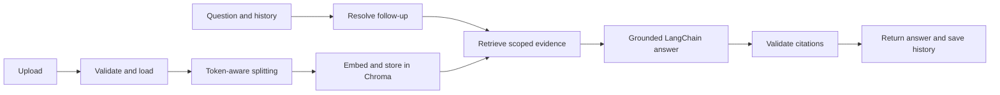

# Folio · LangChain document assistant

Upload PDF, TXT, Markdown or DOCX files and ask questions with source references. Follow-up questions use saved conversation history. The application uses FastAPI, LangChain, Chroma, Hugging Face embeddings and a local Ollama model. This branch contains a fixed RAG pipeline; agent tools and LangGraph are a later project phase.

## Run locally

Requires Linux, Python 3.12 and a running Ollama server.

```bash
python3.12 -m venv venv
source venv/bin/activate
pip install --require-hashes -r requirements.lock
cp .env.example .env  # only if you do not already have a configured .env
python -m scripts.prepare_models
python -m app.server
```

Open **http://127.0.0.1:8000**. In development with no configured accounts, sign in as `local` with an empty access key. Otherwise use an account from `RAG_USERS_JSON`. Model provisioning downloads the pinned embedding model and configured Ollama model; normal startup uses the cache.

1. Add a document and wait for **Ready**. Uploads finish only after indexing succeeds.
2. Select documents, or leave all unchecked to search the whole library.
3. Ask a question. Expand **References** to inspect passages and download the source.
4. Continue asking follow-up questions, or start another conversation.

## How it works



LangChain handles document loaders, text splitting, embeddings, vector search, prompt templates, structured model responses and the runnable pipeline. SQLite stores accounts, document metadata and LangChain messages. Files, vectors and metadata persist under `RAG_DATA_DIR`.

```text
app/
  server.py       API, login and request lifecycle
  config.py       Validated environment settings
  documents.py    Loading, splitting, indexing and deletion
  rag.py          Follow-up → retrieval → grounded answer
  prompts.py      Answer and rewrite instructions
  guardrails.py   Request/response schemas and validation
  storage.py      SQLite documents and conversations
frontend/         HTML, JavaScript and CSS; no build step
tests/           API, document and vector-store regression checks
scripts/          Model setup, evaluation, smoke checks and backup
```

## Behavior and limits

- Answers use retrieved evidence; missing information produces an insufficient-evidence response. Ambiguity and conflicting sources are addressed by the prompt.
- Source IDs are validated against retrieved passages. This checks reference integrity, not whether every generated claim is semantically correct. Review important answers against their sources.
- Obvious instruction-override requests/passages are filtered. Prompt-injection detection is heuristic, not a complete defense.
- Uploads have size, page, extraction and chunk limits. Parsers run in a bounded subprocess. Encrypted, malformed and unreadable PDFs are rejected. Scanned/mixed image PDFs require OCR; blank PDF pages must be removed.
- Duplicate content is indexed once per account and index configuration. Failed/interrupted uploads never become searchable. Restart cleans incomplete uploads; it does not resume them.
- Deleting a document removes access immediately, clears that account's saved answers and removes source/vector data. Failed physical cleanup retries on the next AI operation or restart.
- Login, document scope and conversation access are checked per account. The app runs **one process and one AI operation at a time**. Concurrent operations receive a retryable busy response.
- The default small local model favors low resource use. Answer quality and latency depend on the model and your documents. This is a single-host application, not a horizontally scaled service.

The simpler version removes job polling, document replacement/version management, cached overviews and the redundant CLI client. To update a document, delete it and upload the new file. Existing indexed documents and conversations migrate to the simpler catalog on startup; back up first. The previous data-directory name stays unchanged for compatibility.

## Verify

```bash
pip install -r requirements-dev.txt
ruff check app tests scripts
ruff format --check app tests scripts
PYTEST_DISABLE_PLUGIN_AUTOLOAD=1 OPENBLAS_NUM_THREADS=1 pytest -q
node --check frontend/script.js
python -m scripts.browser_smoke  # requires Chrome, or CHROME_PATH
python -m scripts.smoke_live     # requires cached embeddings and running Ollama
python -m scripts.evaluate --mode retrieval
```

Automated tests use deterministic model responses and real Chroma. Live smoke checks exercise the actual embedding and generation models. Synthetic evaluation is a development check; acceptance testing should use your own representative questions. See [validation](docs/validation.md) for the latest recorded checks and [deployment](docs/operations.md) for Docker and backups.

The generated dependency lockfile is intentionally retained for reproducible CPU installation. LangChain integration references: [Chroma](https://docs.langchain.com/oss/python/integrations/vectorstores/chroma) and [ChatOllama](https://docs.langchain.com/oss/python/integrations/chat/ollama).
